# Nilinde

**An on-device guard against cyberbullying, harassment and grooming, that turns every incident into tamper-evident evidence.**

*Nilinde* (Swahili: "protect me"; formerly *Kuuma*, Luganda for "to guard") watches the messages a child or young person receives on their Android phone. When something is harmful it supports them in the moment, quietly alerts a parent, and keeps a sealed case file that a school, the police or a lawyer can trust. It understands English, Luganda and Swahili, including the mixed-language slang that keyword filters miss.

> Built for Uganda and East Africa. Concept note: [`docs/concept-note.md`](docs/concept-note.md). Developer guide: [`docs/DEVELOPING.md`](docs/DEVELOPING.md).

---

## Contents

- [Why](#why) · [What it does](#what-it-does) · [Screenshots](#screenshots)
- [Architecture](#architecture) · [How a message is judged](#how-a-message-is-judged) · [Evidence pipeline](#evidence-pipeline) · [Trust and privacy model](#trust-and-privacy-model)
- [Technologies](#technologies) · [Repository layout](#repository-layout) · [Run it](#run-it)
- [Testbed and resources](#testbed-and-resources) · [Status](#status)

---

## Why

- **Abuse is common.** 34% of young people in sub-Saharan Africa report being bullied online (UNICEF poll). Most online abuse of Ugandan children happens on WhatsApp and Facebook, usually by someone they know (Disrupting Harm Uganda).
- **Victims stay silent.** A third of abused children told no one.
- **Evidence collapses.** Messages get deleted, accounts renamed and screenshots disputed. Police and schools rarely receive anything they can act on.
- **Filters don't speak local languages.** Insults in Luganda, Runyankole, Swahili or Sheng, often mixed with English, pass unflagged.

Sources and the full problem statement are in the [concept note](docs/concept-note.md#problem-statement).

## What it does

Four jobs: **detect, support, alert, investigate**.

| | For the child | For the parent | For a school, police or lawyer |
| --- | --- | --- | --- |
| **Detect** | Reads incoming WhatsApp and SMS notifications (and the screen, when Android hides them), on the phone | Chooses the apps and the age group | |
| **Support** | Calm, age-appropriate advice, the Sauti 116 helpline, and a keyboard that suggests kinder replies | Guidance on how to talk to the child | |
| **Alert** | Never alerts the sender; Nilinde stays invisible in the chat | An alert with category, severity and app; the message itself only on request, sealed end to end | |
| **Investigate** | Every flagged message is hashed, signed and chained in an encrypted vault. One tap reports it, with no adult's approval needed | Can report a case and keep the child anonymous | A link to a verification page that proves nothing was changed, plus a PDF case file |

## Screenshots

Taken on the Android emulator with invented test messages.

### Child app

| Help when something happens | Advice for the child | The sealed case | Report directly |
| :---: | :---: | :---: | :---: |
|  | 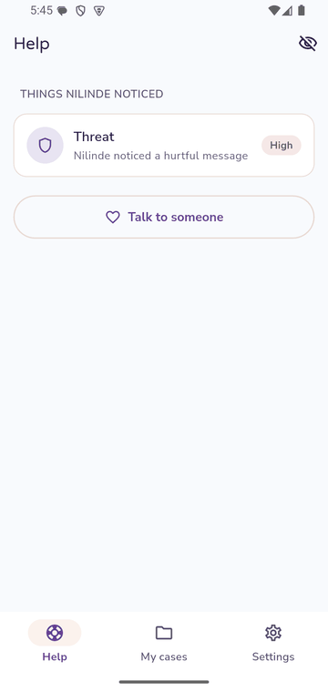 | 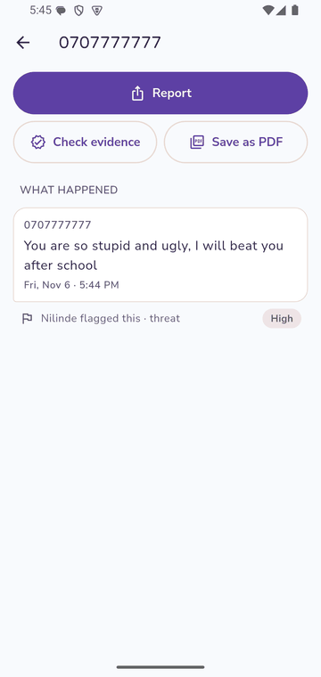 | 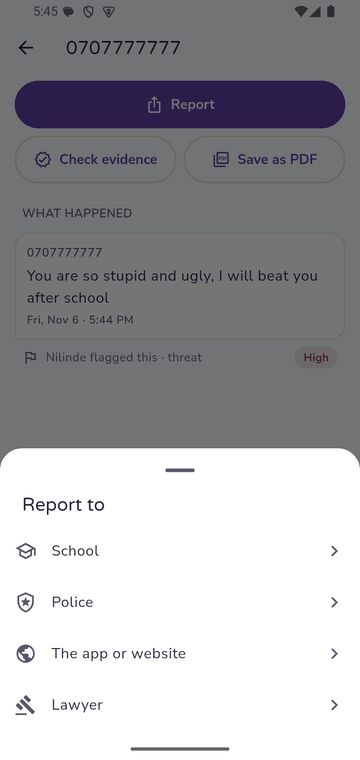 |
| **Send the link** | **Saved evidence** | **PDF case file** | **Saved to Downloads** |
| 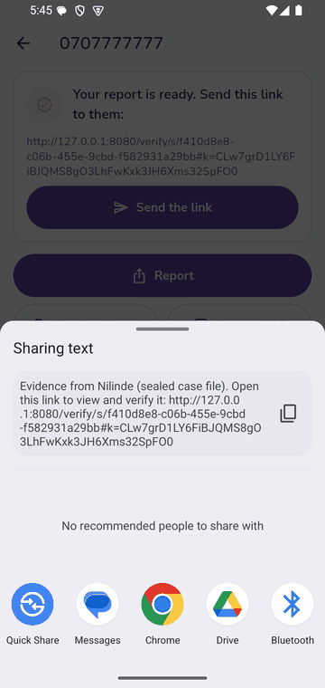 | 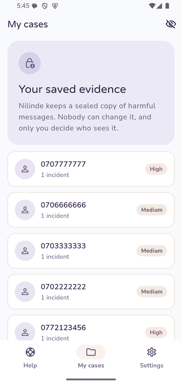 | 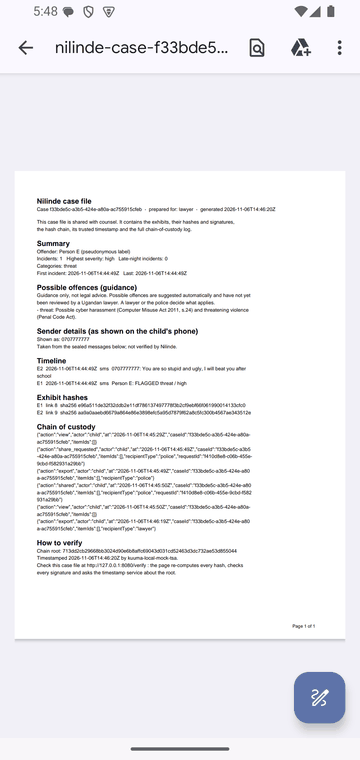 | 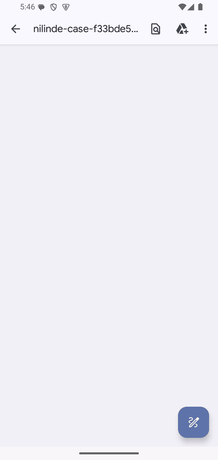 |

### Nilinde Keyboard

| Word suggestions | Personal details | Kindness check |
| :---: | :---: | :---: |
| 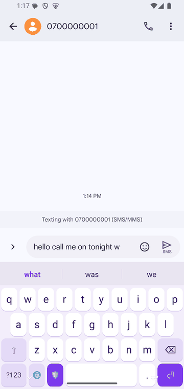 | 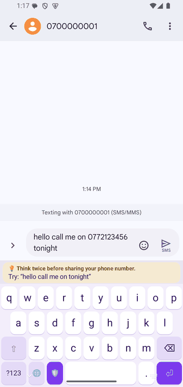 | 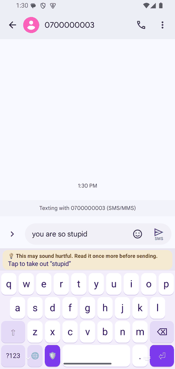 |

### Parent app

| Account (no name, email or number) | Pair with a QR code | Alerts and 7-day trend | The message, on request |
| :---: | :---: | :---: | :---: |
| 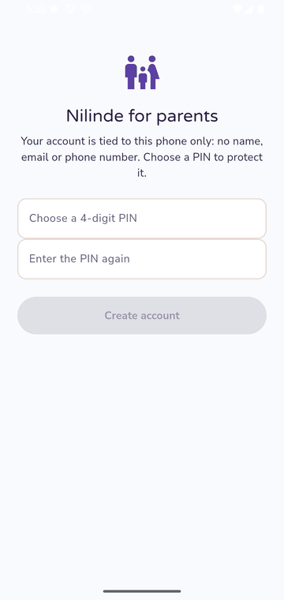 | 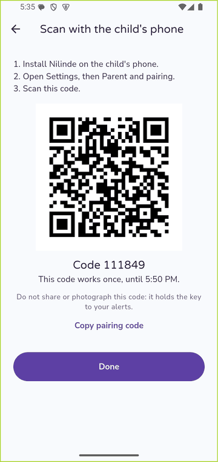 | 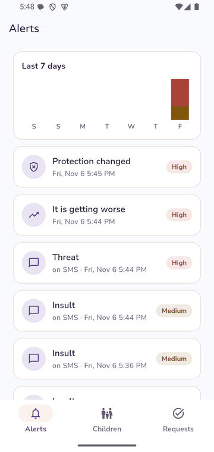 | 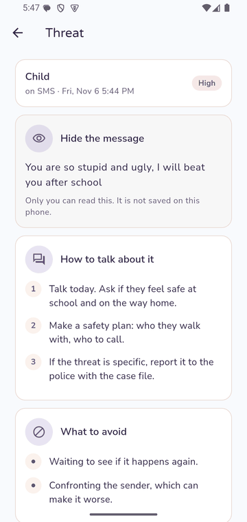 |
| **What to say and avoid** | **Children** | **PIN or fingerprint** | |
| 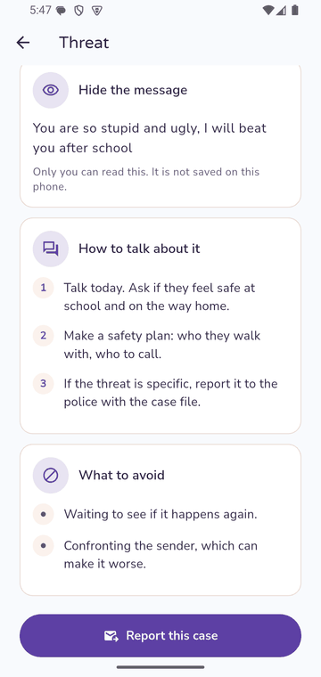 | 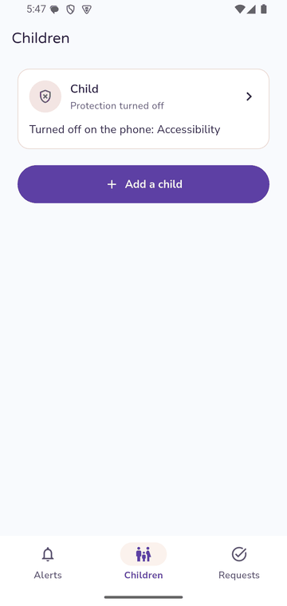 | 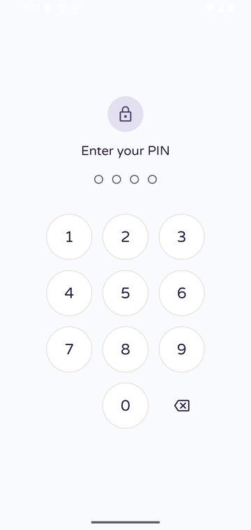 | |

### Setup and verification

| Consent, read together | Permissions | Anyone can verify a case file |
| :---: | :---: | :---: |
| 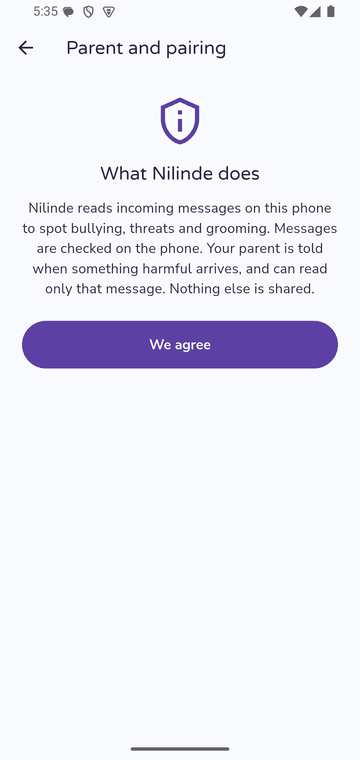 | 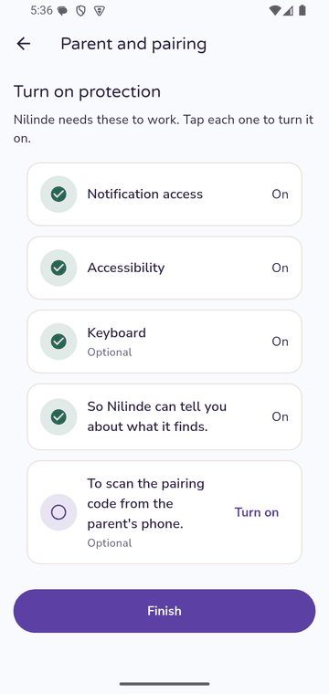 | 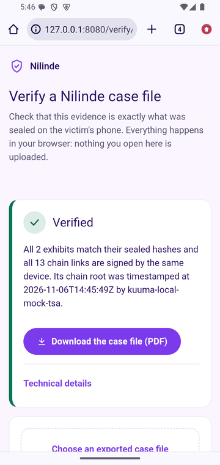 |

---

## Architecture

The phone does the screening and holds the evidence. The cloud only sees redacted text when the phone is unsure, hashes for timestamps, ciphertext it cannot read, and the share links a child chooses to create.

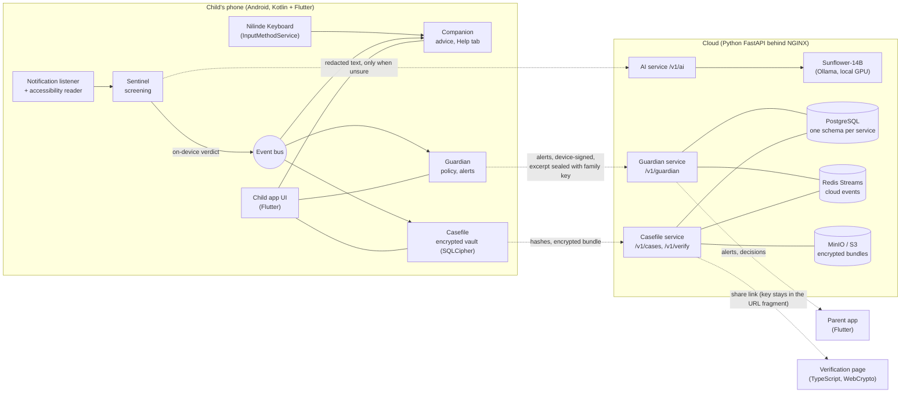

Each part has one owner and talks to the others only through versioned contracts (22 events on the phone's event bus, five OpenAPI files), generated into Kotlin, Dart, Python and TypeScript from one set of JSON Schemas.

| Part | Folder | Runs on | Job |
| --- | --- | --- | --- |
| Core | `packages/`, `apps/`, `infra/` | Both | Contracts, event bus, crypto, storage, UI kit, app shells |
| Sentinel | `modules/sentinel` | Phone | Reads notifications and the screen, screens each message, asks the cloud when unsure |
| Companion | `modules/companion` | Phone + content service | Help tab, advice cards, crisis help, Nilinde Keyboard |
| Casefile | `modules/casefile` | Phone + service + web | Vault, hash chain, cases, PDF case files, shares, verification page |
| Guardian | `modules/guardian` | Phone + service + parent app | Pairing, family key, policy, alerts, reports |
| AI | `ai/`, `packages/kuuma-llm`, `packages/ai-runtime-android` | Both | On-device classifier, Sunflower prompts, the judge, `/v1/ai` |

## How a message is judged

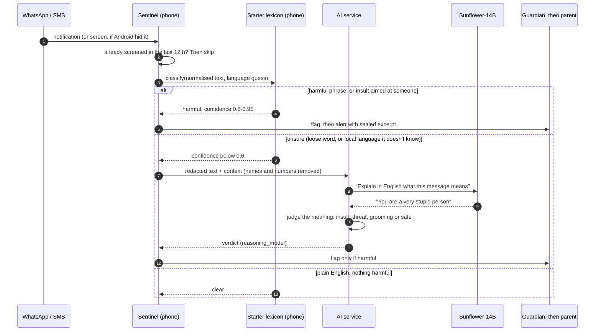

- **On the phone first.** Most messages never leave the device. The starter lexicon (English, Luganda, Swahili, with spelling variants such as *musiru* and *musilu*) flags clear threats and insults aimed at the reader, and passes anything unsure to the cloud.
- **Sunflower for meaning.** Sunbird AI's Sunflower-14B explains what a message means in one English sentence. A rule-based judge reads that sentence, ignoring clauses that deny harm ("there is no threat"), so friendly Luganda stays friendly.
- **Sure verdicts stand.** If the phone is confident a message is harmful, the cloud never overturns it.
- **One message, one alert.** Re-posted notifications, restarts and screen reads of the same message count once.

## Evidence pipeline

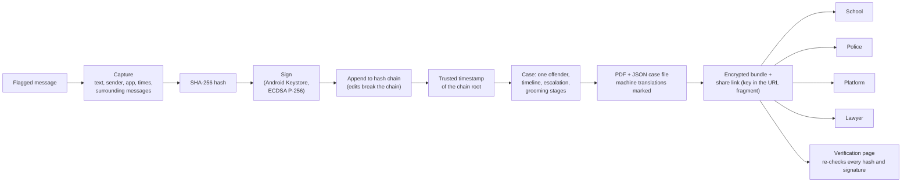

- The custody log records every view, export and share.
- **The child decides.** A child can report directly, with no parent approval, so reporting stays safe even when the problem is at home.
- **The parent can report too**, and keep the child anonymous: no name, none of the child's replies or friends, and messages that name the child are withheld (their hash stays in the chain, so the file still verifies).

## Trust and privacy model

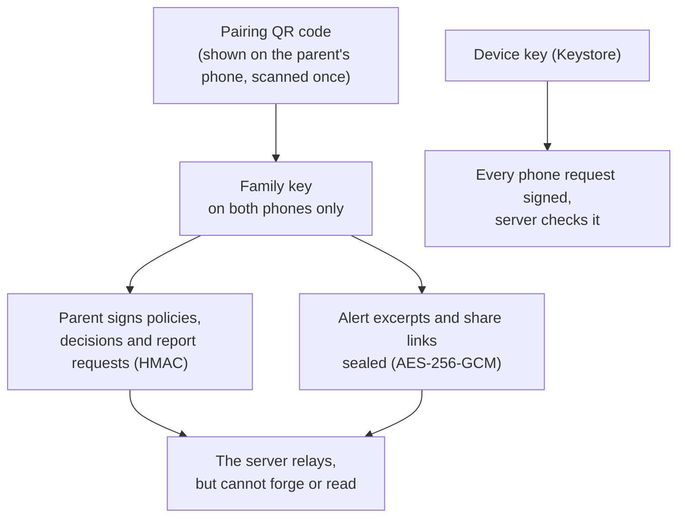

- Unflagged messages are never stored. The cloud sees a random case ID, never the child's name or contacts, and refuses requests that contain phone numbers or emails.
- Silent to the sender: no replies, no read receipts, nothing inside the chat.
- Discreet: quick-hide swaps the app for a dull "Notes" screen, the vault opens with a PIN or fingerprint, and Nilinde's own notifications are worded neutrally.
- Consent is given once, on the child's phone, together with the parent. Nilinde cannot be installed remotely.
- No sexual images of minors are ever copied, viewed or stored: only the fact, a hash and the time.

---

## Technologies

### Built and used in this repository

| Layer | Technology | Used for |
| --- | --- | --- |
| Android services | **Kotlin 2.2**, Android SDK 35 (min API 21) | `NotificationListenerService`, `AccessibilityService` (screen reading), `InputMethodService` (Nilinde Keyboard) |
| App UI | **Flutter 3.27 / Dart 3.6**, platform channels | Child and parent apps, shared `kuuma_ui` design system (soft lavender, Varela Round + Nunito Sans) |
| On-phone storage | **SQLCipher 4.6**, AndroidX SQLite | One encrypted database per module (`sentinel.db`, `vault.db`, `guardian.db`) |
| On-phone crypto | **Android Keystore** (ECDSA P-256, AES-GCM), SHA-256 hash chain, HMAC-SHA256 | Signed exhibits, device-signed requests, family-key signatures and sealing |
| Parent app security | `flutter_secure_storage`, `local_auth` (fingerprint), PBKDF2 (`pointycastle`) | PIN and session storage |
| Pairing | `qr_flutter`, `mobile_scanner` | QR code with a one-time code and the family key |
| On-device AI | Starter lexicon classifier (Kotlin); **TensorFlow Lite (LiteRT 1.4)** wiring for the Knit model | First opinion on every message, offline |
| Local-language AI | **Sunflower-14B** (Sunbird AI, Apache 2.0) on **Ollama**, quantised Q4 | Explaining Luganda, Swahili and Runyankole; machine translation in case files |
| Backend | **Python 3.12, FastAPI 0.115**, Uvicorn, Pydantic 2 | Guardian, Casefile, Companion and AI services |
| Data | **PostgreSQL** (SQLAlchemy 2 + Alembic), **Redis Streams**, **MinIO** (S3) | Per-service schemas, cloud events, encrypted case bundles |
| Gateway and local stack | **NGINX**, **Docker Compose** | One API address, rate limits, local development |
| Verification page | **TypeScript 5.8**, WebCrypto | Decrypts and re-verifies a shared case file in the browser |
| Case files | Hand-written PDF writer in Kotlin | Readable PDF next to the machine-readable bundle |
| Contracts | **JSON Schema** + **OpenAPI 3**, own code generator | Types for Kotlin, Dart, Python and TypeScript from one source |
| Tooling | Gradle 8.14, uv, pnpm, ktlint, ruff, ESLint, Prettier, JUnit, pytest, Vitest, GitHub Actions | `make check`, `make test`, CI and the nightly emulator run |

### Planned (from the concept note)

| Layer | Plan |
| --- | --- |
| Reasoning model | A frontier LLM for intent, severity, grooming stage and offender links (replaces the phase-1 judge) |
| On-device model | Knit / AfroXLMR-class quantised classifier, plus the AI owner's lexicon in `packages/lang/lexicon` |
| Voice notes | Sunflower-Speech transcription |
| Alerts | Firebase Cloud Messaging push, Africa's Talking SMS for basic phones |
| Timestamps | A real RFC 3161 timestamp authority (local builds use a mock) |
| Portals and hosting | Next.js guardian and investigator portals; AWS Cape Town or Huawei Cloud |

## Repository layout

```
apps/child-app        Child app: Flutter + Android host, module registry
apps/parent-app       Parent app: Guardian's screens
modules/sentinel      Detection on the phone
modules/companion     Help tab, advice, crisis help, Nilinde Keyboard (+ content service)
modules/casefile      Vault, cases, PDF, shares (+ service + web verification page)
modules/guardian      Pairing, policy, alerts, reports (+ service + parent screens)
ai/                   AI service, Sunflower setup and prompts, Knit groundwork
packages/contracts    JSON Schemas, OpenAPI, code generator, generated types
packages/core-android Event bus, encrypted storage, crypto, redactor, SafeLog
packages/ui           kuuma_ui: theme, components, translations, lock screen, quick-hide
packages/lang         Shared vocabulary: harm categories, severities, languages, advice keys
packages/kuuma-llm    Sunflower client, prompts, language gate, judge
fakes/                Scripted chats and fake modules for working without the other builds
infra/                Docker Compose, NGINX gateway, PostgreSQL, keys for debug builds
docs/                 Concept note, developer guide, screenshots
```

Code names still say `kuuma` (packages, app IDs, headers); everything people see says Nilinde.

## Run it

```sh
git clone https://github.com/Ashelycole1/KUUMA.git nilinde && cd nilinde
make bootstrap      # toolchains into ~/.kuuma/toolchains (first run ~20 min)
make dev            # local stack: PostgreSQL, Redis, MinIO, all services, gateway on :8080
make apk            # debug child and parent APKs in out/apk/
make check && make test
```

On a real phone over USB, `adb reverse tcp:8080 tcp:8080` lets debug builds reach the laptop's gateway on `127.0.0.1:8080`. Sunflower runs on a local GPU with Ollama: see [`ai/local/sunflower`](ai/local/sunflower) and the [Sunflower integration design](Kuuma%20%E2%80%94%20Sunflower%20Integration%20Design.md). Everything else for builders is in [`docs/DEVELOPING.md`](docs/DEVELOPING.md).

## Testbed and resources

| Resource | How it was used |
| --- | --- |
| **SURFACE-02 laptop** (RTX 3060, 6 GB) | The whole server side: Sunflower-14B on Ollama (about 5-15 s per call), the Guardian, AI and Casefile services behind one gateway on port 8080, and every build |
| **Android emulator** (Android 15, software graphics) | First stop for every change, driven by adb: fake SMS messages, pairing by pasted code, the full report-to-verification flow, keyboard checks |
| **Galaxy A07** (Android 16) | The child's phone: real WhatsApp and SMS. It exposed the repeat alerts, missed Luganda spellings, hidden "sensitive" notifications and the 16 KB page-size warning |
| **Galaxy A13 and A16** (Android 13 and newer) | The parent's phone: a real PIN keypad (exposed the frozen keypad), alerts across two devices |
| **USB tunnels** (`adb reverse`) | Phones reached the laptop with no Wi-Fi setup; a watchdog restored them after a cable was unplugged |
| **Sunbird AI's Sunflower** | Local-language understanding and machine translation, run privately on the laptop |
| **Concept note and builder briefs** | The specification each part was built from |
| **Design system** (`design-system/kuuma/MASTER.md`) | Colours, type and spacing for both apps, the keyboard and the verification page |

## Status

**Working end to end** (emulator and real phones): pairing by QR code, on-device detection with the Sunflower fallback, sealed parent alerts, the child's Help tab and advice, the Nilinde Keyboard and its kindness check, the vault and hash chain, direct reports by the child, parent reports with anonymity, PDF case files, and the verification page.

**Placeholders and known gaps**

- The word lists (`packages/ai-runtime-android/.../starter-lexicon.txt`, the keyboard's `unkind-words.txt`) are starters: a native speaker must review the Luganda and Swahili. The judge is phase-1 rules until the reasoning model is live.
- No push notifications yet: the parent pulls to refresh.
- The child's Help tab forgets incidents when the app restarts (the cases are kept).
- The parent viewing the messages with the child's approval has its contract and service, but not its phone side yet.
- Timestamps come from a local mock authority, and debug builds show Android 16's 16 KB page-size warning.
- Before real users: a Ugandan lawyer reviews the offence mapping and evidence format, and detection meets an agreed accuracy bar (see the [concept note](docs/concept-note.md#mvp-scope-and-roadmap)).

## Help lines

If you or a child you know is in danger, call **Sauti 116** (Uganda's free child helpline).
